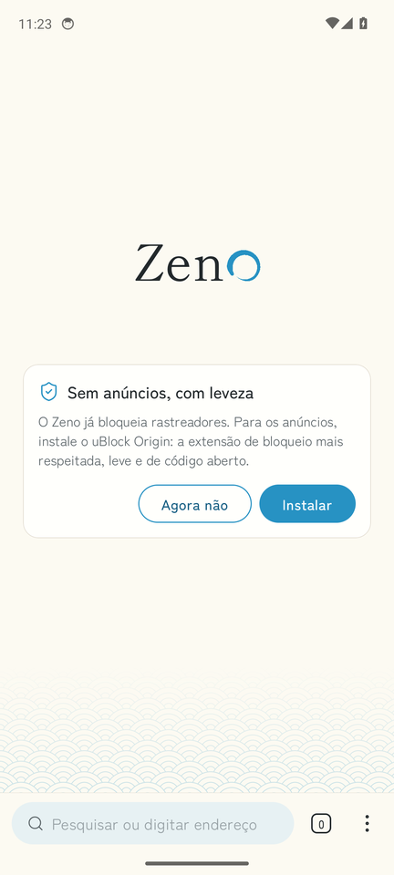
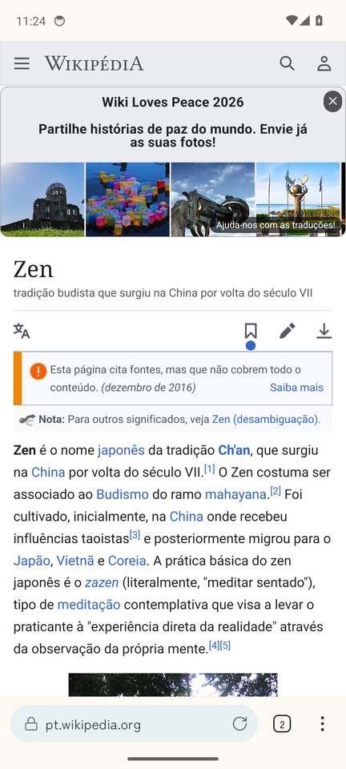
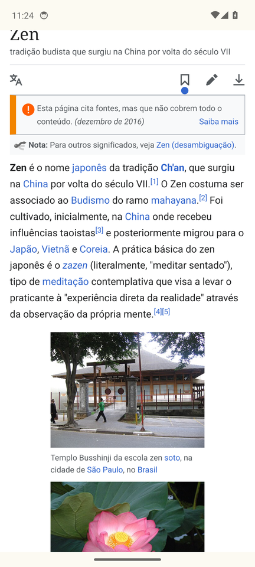
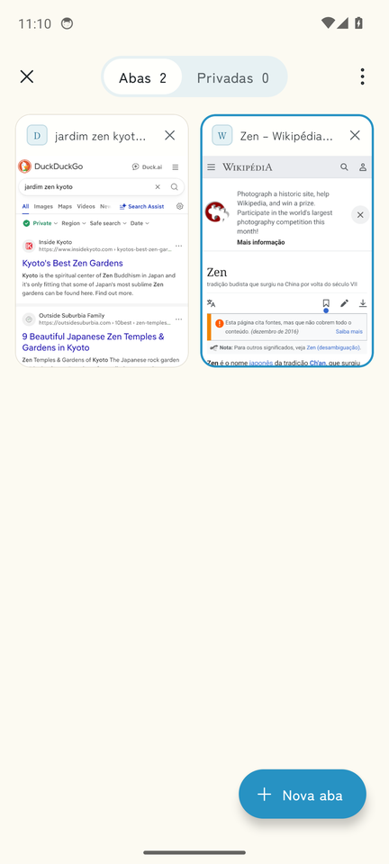
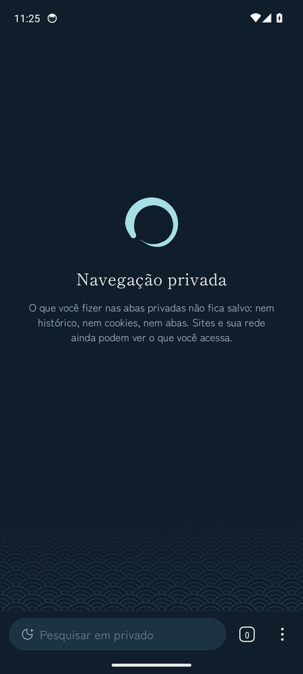

# Zeno

Navegador Android pessoal: leve, silencioso e minimalista, com o motor do Firefox (GeckoView) e um desenho japonês em azul claro — papel, tinta e um ensō.

- **Firefox de verdade por dentro.** GeckoView 158: proteção contra rastreamento com cookies isolados por site (e desligável só num site, pelo cadeado), extensões do addons.mozilla.org (uBlock Origin à distância de um toque), tradução local, modo leitura, DNS seguro.
- **Feito para uma mão.** Barra de endereço embaixo, como no Firefox; abas, menu e pesquisa ao alcance do polegar.
- **Silêncio.** Sem telemetria, sem contas, sem notícias. Notificações de sites só se você ligar; permissões e senhas só ficam guardadas quando você confirma, e as senhas, cifradas no aparelho.
- **Leve.** A página inicial é nativa (abre sem esperar o motor), abas paradas são suspensas e voltam onde estavam.

<p>
  
  
  
  
  
</p>

Capturas do APK de release num emulador Android, tiradas pelo teste de fumaça do CI.

O que já existe está em [`CHANGELOG.md`](CHANGELOG.md).

## Instalar

No celular, baixe o APK em [Releases](https://github.com/blackcocadastudios/zeno/releases) (`zeno-<versão>-arm64.apk`), permita que o navegador ou o gerenciador de arquivos instale apps e abra o arquivo. Se o Android recusar por ser de um desenvolvedor não verificado (no Brasil, desde 30/09/2026), instale pelo computador com `adb install`, ou ligue *Opções do desenvolvedor → Apps de desenvolvedores não verificados*, que pede uma espera única de 24 horas.

Cada push também gera o APK no GitHub Actions: abra a execução mais recente do fluxo **ci**, desça até *Artifacts* e baixe `zeno-arm64` (um zip com o APK para celular).

Para publicar uma versão: suba `versionName` e `versionCode` em `app/build.gradle.kts`, ponha a data na seção do `CHANGELOG.md` e envie a tag `v<versionName>`. O CI publica o release se o build e o teste de fumaça passarem naquele commit; sem chave própria (veja “Assinatura”), ele sai como versão de teste.

Para compilar em casa:

```sh
./gradlew assembleRelease
adb install app/build/outputs/apk/release/app-arm64-v8a-release.apk
```

Há um APK por arquitetura: `arm64-v8a` para celulares e `x86_64` para o emulador. O app de depuração (`assembleDebug`) se chama “Zeno Dev” e convive com o de release.

Requisitos: JDK 17 ou mais novo e o Android SDK (compileSdk 37.2, que o GeckoView 158 exige). O Zeno roda no Android 8.0 (API 26) em diante.

## Assinatura

Builds de release são assinados com a chave de `keystore.properties` (na raiz do projeto, fora do git) ou das variáveis de ambiente `ZENO_KEYSTORE_FILE`, `ZENO_KEYSTORE_PASSWORD`, `ZENO_KEY_ALIAS` e `ZENO_KEY_PASSWORD`.

Sem elas, o release usa a chave de depuração que está no repositório (`app/debug.keystore`, senha `android`). Ela é pública de propósito, para os APKs do CI serem instaláveis — e por isso mesmo **não serve para distribuir**: qualquer pessoa pode assinar um APK com ela.

Para ter uma chave sua:

```sh
keytool -genkeypair -v -keystore zeno-release.jks -alias zeno -keyalg RSA -keysize 4096 -validity 10000
```

```properties
# keystore.properties
storeFile=zeno-release.jks
storePassword=…
keyAlias=zeno
keyPassword=…
```

No GitHub, os mesmos valores vão em *Settings → Secrets and variables → Actions*: `ZENO_KEYSTORE_BASE64` (o arquivo em base64: `base64 -w0 zeno-release.jks`), `ZENO_KEYSTORE_PASSWORD`, `ZENO_KEY_ALIAS` e `ZENO_KEY_PASSWORD`. Com eles, o CI e os releases passam a usar a sua chave. Guarde a chave e as senhas em lugar seguro: o Android só aceita atualizar o app com a mesma chave.

## Como é feito

```
:app            interface (Compose), Activity, downloads, intents
:engine:gecko   o único módulo que conhece o GeckoView
:core:data      histórico, favoritos, downloads e senhas (Room), preferências (DataStore), sessão
:core:design    tokens, tipografia, ícones, ensō, selos — o desenho do Zeno
:core:browser   abas, navegação, endereços e pesquisa (Kotlin puro)
:core:engine    a fronteira com o motor (Kotlin puro)
```

O estado do navegador é um único `StateFlow` imutável dono das abas (`BrowserController`); a interface só lê e envia ações. Detalhes e motivos:

- [`docs/PADROES.md`](docs/PADROES.md) — regras, orçamentos de desempenho, dependências, permissões.
- [`docs/DESIGN.md`](docs/DESIGN.md) — cores tradicionais japonesas, tipografia, ícones, espaçamento.
- [`docs/adr/`](docs/adr) — decisões: GeckoView direto, estado e navegação, silêncio e privacidade, SDK e assinatura, modo leitura, senhas.

## Verificação

`bash tools/ci/gradle-check.sh` roda o que o CI roda: build debug e release, testes na JVM, capturas de tela de todas as telas (Roborazzi, em `*/build/outputs/roborazzi/`) e lint. No CI, um teste de fumaça (`tools/ci/smoke.sh`) instala o APK de release num emulador e o usa de verdade: abre páginas, pesquisa, rola e puxa para recarregar, troca de aba, instala o uBlock Origin, entra no modo privado e mede abertura e memória. Os resultados ficam nos artefatos de cada execução: `zeno-report` (resumo, relatórios e capturas das telas) e `zeno-smoke` (passos, capturas do emulador e medições).

## Licenças

O código do Zeno ainda não tem licença definida. Componentes de terceiros: GeckoView (MPL 2.0), Readability da Mozilla (Apache 2.0, em `third_party/readability`), fontes Zen Kaku Gothic New e Shippori Mincho (SIL Open Font License 1.1, em `third_party/fonts`) e ícones Lucide (ISC, em `third_party/lucide`).
